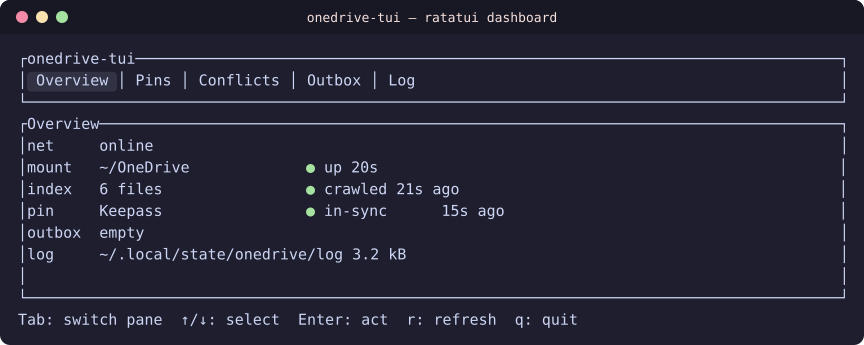
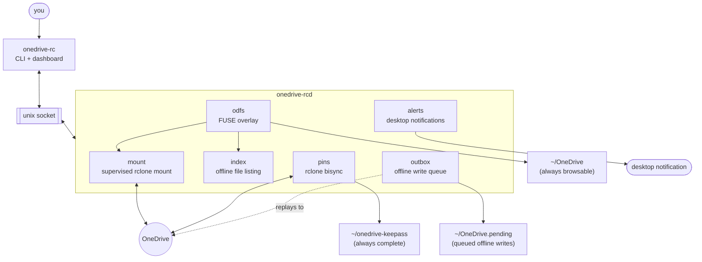

# onedrive-rc

Reliable OneDrive access on Linux, built on [rclone](https://rclone.org) — a
background daemon keeps `~/OneDrive` mounted and browsable even offline, pins
folders you need complete locally, and never discards one version of a
conflicted file in favor of another.

## Install (NixOS, flake)

```nix
{
  inputs.onedrive-rc.url = "github:Yolo-TM/onedrive-mount/v0.3.3";

  outputs = { nixpkgs, onedrive-rc, ... }: {
    nixosConfigurations.your-hostname = nixpkgs.lib.nixosSystem {
      modules = [
        ./configuration.nix
        onedrive-rc.nixosModules.default
        { services.onedrive-rc = { enable = true; users = [ "yourusername" ]; }; }
      ];
    };
  };
}
```

Then `onedrive-rc setup` once you've rebuilt. That installs the package and
the systemd user unit for you; it does *not* generate `config.toml` — do that
declaratively too with the Home Manager module below, or let `setup` ask you a
few questions and write it. Other install paths (classic `configuration.nix`,
Home Manager, pre-built binaries, building from source) are below.





## Components

| | |
| --- | --- |
| [`onedrive-rcd`](crates/daemon/README.md) | the daemon — mounts, pins, the offline index, conflict handling, the outbox |
| [`onedrive-rc`](crates/cli/README.md) | CLI + dashboard — `status`, `doctor`, `pin`, `conflicts`, `outbox`, `setup`, … |
| [`onedrive-rc-core`](crates/core/README.md) | the shared library behind both |

Each has its own README for what it does and how to use it. The full design,
the data-safety contract, and the reasoning (and verification) behind every
decision are in [`docs/OVERHAUL.md`](docs/OVERHAUL.md) — start there for *why*,
the component READMEs for *how*.

## Prerequisites

- [rclone](https://rclone.org) on `$PATH`
- `fuse3`, with unprivileged user mounts allowed
- a `systemd --user` session

## Install

### NixOS (classic `configuration.nix`, no flake)

```nix
{ config, pkgs, lib, ... }:
let
  onedrive-rc = builtins.getFlake "github:Yolo-TM/onedrive-mount/v0.3.3";
in {
  imports = [ onedrive-rc.nixosModules.default ];
  services.onedrive-rc = {
    enable = true;
    users = [ "yourusername" ];
  };
}
```

```sh
sudo nixos-rebuild switch
```

### NixOS — declare each user's mounts and pins (no Home Manager)

`services.onedrive-rc.userConfigs.<user>` takes the same options as the Home
Manager module below and writes `~/.config/onedrive-rc/config.toml` for that
user, as a symlink into the Nix store (via `systemd.tmpfiles`). Users listed
here get linger automatically.

```nix
services.onedrive-rc = {
  enable = true;
  userConfigs.yourusername.remotes.onedrive-timm = {
    mount_point = "~/OneDrive";
    pins.Keepass = {
      remote_path = "Dokumente/Keepass";
      local_path = "~/onedrive-keepass";
    };
  };
};
```

Things to know: the file is read-only, and the first switch **replaces** an
existing hand-written `config.toml` for that user (move it aside first if you
want to keep it). The rclone remote must already exist in that user's
`rclone.conf` — run `onedrive-rc setup` once as that user to authenticate. Don't
declare the same user here *and* in Home Manager; they would fight over the file.

### Home Manager — declare `config.toml` itself

`services.onedrive-rc` (NixOS, above) installs the package and the systemd user
unit, but mount points, pins and VFS tuning are per-user, so they can live in
their own module. `homeManagerModules.default` generates
`~/.config/onedrive-rc/config.toml` from Nix options instead — every key in
[`config.example.toml`](config.example.toml) is an option here, with the same
defaults, so declaring nothing beyond `mount_point` gets you the same sensible
VFS/FUSE defaults the example file documents.

```nix
{
  inputs.onedrive-rc.url = "github:Yolo-TM/onedrive-mount/v0.3.3";

  outputs = { home-manager, onedrive-rc, ... }: {
    homeConfigurations.yourusername = home-manager.lib.homeManagerConfiguration {
      modules = [
        onedrive-rc.homeManagerModules.default
        {
          services.onedrive-rc = {
            enable = true;
            remotes.onedrive-timm = {
              mount_point = "~/OneDrive";
              # Everything else — vfs_cache_mode, dir_cache_time, poll_interval,
              # transfers, ... — defaults to what config.example.toml documents.
              # Override only what you need, e.g.:
              mount.vfs_cache_max_size = "40G";

              pins.Keepass = {
                remote_path = "Dokumente/Keepass";
                local_path = "~/onedrive-keepass";
              };
            };
          };
        }
      ];
    };
  };
}
```

The attribute name (`onedrive-timm` above) becomes the rclone remote name —
it must already exist in `rclone.conf`, authenticated, which this module does
not do for you: run `rclone config create onedrive-timm onedrive` (or plain
interactive `rclone config`) first. After `home-manager switch` and
authenticating, run `onedrive-rc setup` once: it detects the config this
module already wrote and goes straight to installing/starting the service
instead of asking the usual setup questions.

This module is standalone — it works the same way on non-NixOS Linux with
Home Manager installed directly, which is the quickest fully-declarative path
if you are not otherwise on NixOS. If you are *also* using the NixOS
`services.onedrive-rc` module above, both will define a `systemd.user.services.
onedrive-rcd` unit; that is harmless, just redundant (systemd uses the user-level
one from Home Manager). Set this module's `services.onedrive-rc.systemdService.
enable = false` if you'd rather the NixOS module's copy be the only one.

### Pre-built binaries (GitHub releases)

| Artifact | Links against | Use when |
| --- | --- | --- |
| `onedrive-rcd-x86_64-linux-musl` / `onedrive-rc-x86_64-linux-musl` | nothing (fully static) | any Linux |
| `onedrive-rcd-x86_64-linux` / `onedrive-rc-x86_64-linux` | glibc | Debian, Fedora, Arch, etc. |
| `onedrive-rcd-x86_64-linux-nix` / `onedrive-rc-x86_64-linux-nix` | Nix store (rpath-patched) | NixOS, manual install without the flake |

```sh
curl -L https://github.com/Yolo-TM/onedrive-mount/releases/latest/download/onedrive-rcd-x86_64-linux-musl \
  -o ~/.local/bin/onedrive-rcd && chmod +x ~/.local/bin/onedrive-rcd
curl -L https://github.com/Yolo-TM/onedrive-mount/releases/latest/download/onedrive-rc-x86_64-linux-musl \
  -o ~/.local/bin/onedrive-rc && chmod +x ~/.local/bin/onedrive-rc
```

### Build from source

```sh
nix develop            # or just: cargo build --release --workspace
cargo build --release -p onedrive-rcd -p onedrive-rc
cp target/release/{onedrive-rcd,onedrive-rc} ~/.local/bin/
```

## First-time setup

```sh
onedrive-rc setup
```

See [`crates/cli/README.md`](crates/cli/README.md) for what it asks and what
`onedrive-rc --reauth` does. Config lives at `~/.config/onedrive-rc/config.toml`
— every field, its default, and what it does is in
[`config.example.toml`](config.example.toml), and on Nix it can be generated
entirely from options instead (see Home Manager, above). If a config already
exists — hand-written or Nix-generated — `setup` reuses it rather than asking
questions, and goes straight to installing the service (the rclone remote
itself still needs to be authenticated separately, with `rclone config` or
`onedrive-rc setup --reauth <name>` for a token refresh).
